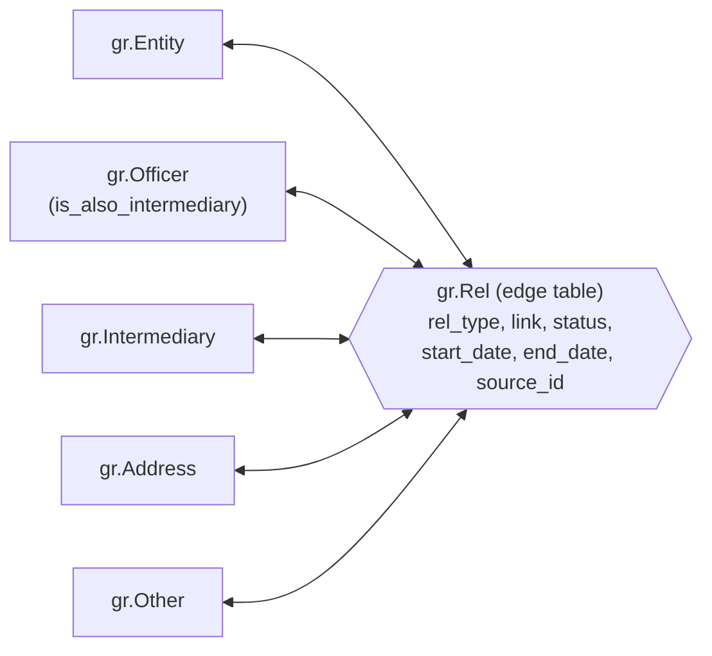

ICIJ Offshore Leaks Database: Relational Modeling and Graph Analysis Using SQL Server
================
By Kevin Arias

## Project Overview

This project is a personal portfolio project. I selected this topic due to some interest in financial transparency, large relational datasets and graph databases. In this project, I use *SQL Server* (T-SQL and *SQL Server Management Studio 22*) for the entire process: loading raw CSV files into staging tables, building a typed relational model, validating it, and building a **graph model** with SQL Server graph tables (`NODE` and `EDGE`) to analyze how offshore structures are connected.

The dataset comes from the *ICIJ Offshore Leaks Database*, published by the International Consortium of Investigative Journalists (ICIJ). I used the CSV package of the database, which contains **6 files**: 5 node files (addresses, entities, intermediaries, officers and others) and 1 relationships file. In total there are about **2.0 million nodes** and **3.3 million relationships**. The database consolidates information from five ICIJ investigations: Offshore Leaks (2013), Panama Papers (2016), Bahamas Leaks (2016), Paradise Papers (2017) and Pandora Papers (2021). I used the `full-oldb.LATEST.zip` package.

The main **objective** is to build a reproducible pipeline that takes the raw CSV files to a validated relational model and a graph model, and to use it to answer questions about the structure of the network: which link types dominate, how concentrated the intermediaries and registered addresses are, and how entities, officers and intermediaries connect.

**Scope and attribution:** the data and the conceptual model (entities, officers, intermediaries, addresses and their relationships) are published by ICIJ, who also provide the data as a Neo4j graph. My contribution is the implementation: a reproducible SQL Server pipeline that loads the raw CSV files, validates them, resolves data quality issues and builds the graph with SQL Server graph tables, followed by an analysis of the network. I chose SQL Server (2025 Express) to practice a complete relational and graph workflow in one engine, and I note its limitations compared with a native graph database.

> **Important:** appearing in this database does not imply wrongdoing. There are legitimate uses for offshore companies and trusts. This project analyzes the structure of the data and presents aggregated results only.

For readability, I have divided this project into **5 phases** as follows:

- **Phase 1:** Creating the database and the staging tables.

- **Phase 2:** Loading the raw CSV files.

- **Phase 3:** Building the typed relational model.

- **Phase 4:** Building the graph model.

- **Phase 5:** Graph analysis and sharing insights.

&nbsp;

## Phase 1: Creating the database and the staging tables

All the scripts are in the `SQL` folder of the repository and are numbered in execution order. Every script can be rerun safely, because it drops and recreates its own objects (`IF OBJECT_ID(...) IS NOT NULL DROP TABLE ...`).

### 1.1 The raw files

| File | Content | Records |
|---|---|---|
| `nodes-entities.csv` | Companies, trusts and funds | 814,344 |
| `nodes-officers.csv` | People or companies with a role in an entity | 771,315 |
| `nodes-addresses.csv` | Addresses | 402,246 |
| `nodes-intermediaries.csv` | Firms or people that set up and manage entities | 26,768 |
| `nodes-others.csv` | Other nodes | 2,989 |
| `relationships.csv` | Links between any two nodes | 3,339,267 |

`relationships.csv` is too large to open in Excel, so I inspected the files from the command line (see section 2.2).

### 1.2 Creating the database

```sql
-- Create the database if it does not exist
IF DB_ID('ICIJ_OffshoreLeaks') IS NULL
    CREATE DATABASE ICIJ_OffshoreLeaks;
GO
```

### 1.3 Creating the staging tables

I create one staging table per CSV in the `stg` schema and store **every column as text**, so that the load never fails because of a data type and I control the types myself in the next phases.

```sql
USE ICIJ_OffshoreLeaks;
GO

-- Create the staging schema if it does not exist
IF SCHEMA_ID('stg') IS NULL
    EXEC('CREATE SCHEMA stg');
GO

-- Store all columns as text, assign real types in the typed model
IF OBJECT_ID('stg.relationships', 'U') IS NOT NULL DROP TABLE stg.relationships;
CREATE TABLE stg.relationships (
    node_id_start NVARCHAR(MAX), node_id_end NVARCHAR(MAX), rel_type NVARCHAR(MAX),
    link NVARCHAR(MAX), status NVARCHAR(MAX), start_date NVARCHAR(MAX),
    end_date NVARCHAR(MAX), sourceID NVARCHAR(MAX)
);
```

The other five tables follow the same pattern, with the columns of each CSV in the same order as the file (the load maps columns by position).

&nbsp;

## Phase 2: Loading the raw CSV files

I load each file with `BULK INSERT`. The files contain quoted text with commas and, in a few cases, line breaks inside a field, so I use `FORMAT = 'CSV'` with the quote character defined.

```sql
-- Load the file, skip the header, read as UTF-8, rows end with LF
BULK INSERT stg.relationships
FROM 'F:\data-analyst-portfolio\ICIJ Offshore Leaks - SQL Server\Data\Raw\relationships.csv'
WITH (FORMAT = 'CSV', FIRSTROW = 2, FIELDQUOTE = '"', CODEPAGE = '65001',
      ROWTERMINATOR = '0x0a', TABLOCK);
```

### 2.1 A loading problem: line endings

My first attempt failed in every file with the error *"Cannot obtain the required interface ('IID_IColumnsInfo') from OLE DB provider 'BULK'"*. I ruled out permissions (SQL Server could read the file with `OPENROWSET`), column sizes and the code page. A tiny test CSV loaded correctly, and the difference was the **line ending**: the ICIJ files end each line with LF only (`0x0a`), while my test file used Windows line endings. Adding `ROWTERMINATOR = '0x0a'` solved it.

### 2.2 Checking the load

I check the load by comparing the lines of each CSV file with the rows loaded in each staging table.

```powershell
# Show the columns and the number of data lines of each CSV
Get-ChildItem *.csv | ForEach-Object {
    [pscustomobject]@{
        file    = $_.Name
        columns = (Get-Content $_.FullName -TotalCount 1)
        lines   = ([System.IO.File]::ReadLines($_.FullName) | Measure-Object).Count - 1
    }
} | Format-List
```

```
>## file    : nodes-addresses.csv
>## lines   : 402320
>##
>## file    : nodes-entities.csv
>## lines   : 814616
>##
>## file    : nodes-intermediaries.csv
>## lines   : 26774
>##
>## file    : nodes-officers.csv
>## lines   : 771368
>##
>## file    : nodes-others.csv
>## lines   : 2989
>##
>## file    : relationships.csv
>## lines   : 3339271
```

```sql
-- Check loaded row counts
SELECT 'nodes_addresses' AS table_name, COUNT(*) AS row_count FROM stg.nodes_addresses
UNION ALL SELECT 'nodes_entities', COUNT(*) FROM stg.nodes_entities
UNION ALL SELECT 'nodes_intermediaries', COUNT(*) FROM stg.nodes_intermediaries
UNION ALL SELECT 'nodes_officers', COUNT(*) FROM stg.nodes_officers
UNION ALL SELECT 'nodes_others', COUNT(*) FROM stg.nodes_others
UNION ALL SELECT 'relationships', COUNT(*) FROM stg.relationships;
```

```
>## table_name            row_count
>## nodes_addresses       402246
>## nodes_entities        814344
>## nodes_intermediaries  26768
>## nodes_officers        771315
>## nodes_others          2989
>## relationships         3339267
```

The lines of the CSV files do not match the loaded rows in five of the six tables (for example, 3,339,271 lines against 3,339,267 rows in `relationships`). The difference could come from line breaks inside quoted fields, so I count them in every staging table.

```sql
-- Count line breaks inside fields for every staging table
DECLARE @sql NVARCHAR(MAX);

SELECT @sql = STRING_AGG(CAST(
    N'SELECT ''' + t.name + N''' AS table_name, '
  + N'SUM(CAST(' + x.expr + N' AS BIGINT)) AS embedded_line_breaks '
  + N'FROM stg.[' + t.name + N']' AS NVARCHAR(MAX)), N' UNION ALL ')
FROM sys.tables t
CROSS APPLY (
    SELECT STRING_AGG(CAST(
        N'ISNULL(LEN([' + c.name + N']) - LEN(REPLACE([' + c.name + N'], CHAR(10), '''')), 0)'
        AS NVARCHAR(MAX)), N' + ') AS expr
    FROM sys.columns c
    WHERE c.object_id = t.object_id
) x
WHERE SCHEMA_NAME(t.schema_id) = 'stg';

EXEC (@sql);
```

```
>## table_name            embedded_line_breaks
>## nodes_addresses       74
>## nodes_entities        272
>## nodes_intermediaries  6
>## nodes_officers        53
>## nodes_others          0
>## relationships         4
```

- In each table, the difference between lines and records equals the number of line breaks inside quoted fields, so no record was lost. In `relationships.csv`, for example, 3 records contain 4 line breaks in total.

&nbsp;

## Phase 3: Building the typed relational model

In this phase I convert the text staging tables into typed tables in the `dbo` schema: `addresses`, `entities`, `intermediaries`, `officers`, `others` and `relationships`.

### 3.1 Design decisions

- **Primary key on `node_id` (`BIGINT`)** in the five node tables.
- **Empty strings become `NULL`** with `NULLIF(LTRIM(RTRIM(column)), '')`.
- **Dates** are converted to `DATE` with `TRY_CONVERT`, which returns `NULL` instead of failing when a value cannot be converted.
- **Column sizes**: my first version used tight sizes and the inserts failed with *"String or binary data would be truncated"* (country code lists in officers and long text in `link`). Instead of guessing, I measured the longest value of every staging column with a dynamic query. The longest value is **865 characters** (`note`), so I use `NVARCHAR(4000)` for all text columns.

```sql
-- Measure the longest value of every staging column
DECLARE @sql NVARCHAR(MAX);

SELECT @sql = STRING_AGG(CAST(
    N'SELECT ''' + t.name + N''' AS table_name, ''' + c.name + N''' AS column_name, '
  + N'MAX(LEN([' + c.name + N'])) AS max_len FROM stg.[' + t.name + N']'
    AS NVARCHAR(MAX)), N' UNION ALL ')
FROM sys.tables t
JOIN sys.columns c ON c.object_id = t.object_id
WHERE SCHEMA_NAME(t.schema_id) = 'stg';

SET @sql = @sql + N' ORDER BY max_len DESC';
EXEC (@sql);
```

```sql
-- Load relationships, converting date text to DATE
INSERT INTO dbo.relationships
SELECT
    CAST(node_id_start AS BIGINT),
    CAST(node_id_end AS BIGINT),
    NULLIF(LTRIM(RTRIM(rel_type)), ''),
    NULLIF(LTRIM(RTRIM(link)), ''),
    NULLIF(LTRIM(RTRIM(status)), ''),
    TRY_CONVERT(DATE, NULLIF(LTRIM(RTRIM(start_date)), '')),
    TRY_CONVERT(DATE, NULLIF(LTRIM(RTRIM(end_date)), '')),
    NULLIF(LTRIM(RTRIM(sourceID)), '')
FROM stg.relationships;
```

### 3.2 Validations

The script ends with three validations.

**Validation 1: row counts.** Staging and typed tables have the same number of rows in all six tables.

**Validation 2: dates that failed to convert** (a raw value exists but the typed value is `NULL`).

My first assumption was a single date format (`dd-MMM-yyyy`, for example `02-NOV-2007`), and **242,635** relationship start dates failed. Looking at the failing values showed that the source **mixes two formats**: `dd-MMM-yyyy` and ISO `yyyy-mm-dd`. Using `TRY_CONVERT(DATE, ...)` without a style, with the session language set to English, parses both. After the fix:

| Column | Failed conversions |
|---|---|
| entities (4 date columns) | 0 |
| relationships.start_date | 379 |
| relationships.end_date | 11 |

- The 390 remaining values are irregular formats of the source (`dd/mm/yy`, `mmddyyyy`, month and year only, `*`). I store them as `NULL` instead of guessing, which affects about **0.01%** of the relationships.

**Validation 3: orphan relationships.** I check that every relationship endpoint exists in at least one node table.

```
>## -- Validation 1: row counts, staging vs typed
>## table_name      staging_rows   typed_rows
>## addresses       402246         402246
>## entities        814344         814344
>## intermediaries  26768          26768
>## officers        771315         771315
>## others          2989           2989
>## relationships   3339267        3339267
>##
>## -- Validation 2: dates that failed to convert
>## date_column                    failed_conversions
>## entities.incorporation_date    0
>## entities.inactivation_date     0
>## entities.struck_off_date       0
>## entities.dorm_date             0
>## relationships.start_date       379
>## relationships.end_date         11
>##
>## -- Validation 3: orphan relationships
>## orphan_start   orphan_end
>## 0              0
```

&nbsp;

## Phase 4: Building the graph model

SQL Server graph tables store nodes and edges as tables and allow pattern matching with `MATCH`. I create **5 node tables** in the `gr` schema (`Entity`, `Officer`, `Intermediary`, `Address`, `Other`) and **one edge table** (`gr.Rel`) for all relationship types, because in this dataset a relationship can connect any combination of node types. The node tables keep the columns needed for analysis, and the rest stay in `dbo` and can be joined by `node_id`.

```sql
-- Create node tables and the single edge table
CREATE TABLE gr.Entity (
    node_id            BIGINT         NOT NULL,
    name               NVARCHAR(4000) NULL,
    jurisdiction       NVARCHAR(4000) NULL,
    company_type       NVARCHAR(4000) NULL,
    status             NVARCHAR(4000) NULL,
    incorporation_date DATE           NULL,
    struck_off_date    DATE           NULL,
    country_codes      NVARCHAR(4000) NULL,
    source_id          NVARCHAR(4000) NULL
) AS NODE;

CREATE TABLE gr.Rel (
    rel_type   NVARCHAR(4000) NULL,
    link       NVARCHAR(4000) NULL,
    status     NVARCHAR(4000) NULL,
    start_date DATE           NULL,
    end_date   DATE           NULL,
    source_id  NVARCHAR(4000) NULL
) AS EDGE;
```

### 4.1 Translating node IDs into graph IDs

Edges do not use my `node_id`, but the internal `$node_id` that SQL Server assigns to each node. I build a temporary map from `node_id` to `$node_id` and use it to load both endpoints of every edge.

```sql
-- Map each original node_id to its internal graph $node_id
SELECT node_id, graph_id INTO #node_map FROM (
    SELECT node_id, $node_id AS graph_id FROM gr.Entity
    UNION ALL SELECT node_id, $node_id FROM gr.Officer
    UNION ALL SELECT node_id, $node_id FROM gr.Intermediary
    UNION ALL SELECT node_id, $node_id FROM gr.Address
    UNION ALL SELECT node_id, $node_id FROM gr.Other
) m;
CREATE UNIQUE CLUSTERED INDEX ix_node_map ON #node_map (node_id);

-- Load edges, translating both endpoints through the map
INSERT INTO gr.Rel ($from_id, $to_id, rel_type, link, status, start_date, end_date, source_id)
SELECT s.graph_id, e.graph_id,
       r.rel_type, r.link, r.status, r.start_date, r.end_date, r.source_id
FROM dbo.relationships r
JOIN #node_map s ON s.node_id = r.node_id_start
JOIN #node_map e ON e.node_id = r.node_id_end;
```

### 4.2 A modeling problem: the same ID in two node tables

The unique index of the map failed with a duplicate key. The cause was that **1,139 `node_id` values exist in both `officers` and `intermediaries`**, with the same name in both tables. They are parties that act in both roles, and the dataset lists them in two files. Since relationships only contain the ID and not the node type, an ID in two tables would make the endpoint ambiguous. My previous orphan check could not detect this, because it only verified that each ID existed somewhere.

I decided that a **node represents an identity and the role is described by the edge**. These 1,139 nodes are loaded once, in `gr.Officer`, with a flag `is_also_intermediary = 1`, and excluded from `gr.Intermediary`. The role is still visible in the edges, for example `link = 'intermediary of'`. These nodes are involved in 53,017 relationships (1.6% of the total).

```sql
-- Flag officers that also appear as intermediaries
INSERT INTO gr.Officer (node_id, name, country_codes, source_id, is_also_intermediary)
SELECT o.node_id, o.name, o.country_codes, o.source_id,
       CASE WHEN EXISTS (SELECT 1 FROM dbo.intermediaries i WHERE i.node_id = o.node_id)
            THEN 1 ELSE 0 END
FROM dbo.officers o;

-- Skip intermediaries already loaded as officers to keep one node per identity
INSERT INTO gr.Intermediary (node_id, name, status, country_codes, source_id)
SELECT i.node_id, i.name, i.status, i.country_codes, i.source_id
FROM dbo.intermediaries i
WHERE NOT EXISTS (SELECT 1 FROM dbo.officers o WHERE o.node_id = i.node_id);
```

### 4.3 Validation of the graph

| Graph table | Rows | Expected |
|---|---|---|
| Entity | 814,344 | 814,344 |
| Officer | 771,315 | 771,315 |
| Intermediary | 25,629 | 25,629 (26,768 minus 1,139) |
| Address | 402,246 | 402,246 |
| Other | 2,989 | 2,989 |
| **Nodes in total** | **2,016,523** | |
| Rel (edges) | 3,339,267 | 3,339,267 |

The database occupies about **6 GB** including the staging, typed and graph copies of the data.

The following diagram summarizes the graph model: five node tables and a single edge table, `gr.Rel`, that can connect any pair of node types.



&nbsp;

## Phase 5: Graph analysis and sharing insights

The analysis queries are in `06_analysis_queries.sql`. Results are shown in aggregated form.

### 5.1 Most frequent relationship types

```sql
SELECT TOP 10 link, COUNT(*) AS edges
FROM gr.Rel
GROUP BY link
ORDER BY edges DESC;
```

| Link | Edges |
|---|---|
| shareholder of | 589,938 |
| registered address | 566,910 |
| intermediary of | 516,650 |
| director of | 457,922 |
| registered office | 164,290 |
| secretary of | 115,652 |
| judicial representative of | 109,526 |
| same name as | 104,170 |
| legal representative of | 99,181 |
| registered agent of | 78,737 |

- The **top 4 link types represent about 64%** of all edges.

### 5.2 Entities by jurisdiction and status

```sql
SELECT TOP 15 jurisdiction, COALESCE(status, '(no status)') AS status, COUNT(*) AS entities
FROM gr.Entity
GROUP BY jurisdiction, status
ORDER BY entities DESC;
```

| Jurisdiction | Status | Entities |
|---|---|---|
| BAH | (no status) | 193,688 |
| KNA | (no status) | 70,516 |
| BVI | Active | 62,233 |
| MLT | (no status) | 57,744 |
| BVI | Defaulted | 56,053 |
| AW | (no status) | 49,050 |
| BRB | (no status) | 40,839 |
| XXX | Dead | 23,095 |
| XXX | Active | 17,137 |
| PMA | Defaulted | 15,978 |

Jurisdiction codes are those of the source, which describes `AW` as Aruba and `XXX` as "Undetermined" (a small share of `XXX` entities, 103, is recorded in the leaked files as "fund"). The remaining codes are `BAH` (Bahamas), `KNA` (Saint Kitts and Nevis), `BVI` (British Virgin Islands), `MLT` (Malta), `BRB` (Barbados) and `PMA` (Panama).

- Several jurisdictions have **no status at all** in the source (for example, the 193,688 entities of `BAH`), so I keep them as `NULL` (the query shows them as `(no status)`).

### 5.3 Concentration of intermediaries and registered addresses

```sql
-- Intermediaries serving the most entities
-- Parties acting in both roles live in gr.Officer, so query both node tables
SELECT TOP 10 name, SUM(entities_served) AS entities_served
FROM (
    SELECT i.node_id, i.name, COUNT(*) AS entities_served
    FROM gr.Intermediary i, gr.Rel r, gr.Entity e
    WHERE MATCH(i-(r)->e) AND r.link = 'intermediary of'
    GROUP BY i.node_id, i.name
    UNION ALL
    SELECT o.node_id, o.name, COUNT(*)
    FROM gr.Officer o, gr.Rel r, gr.Entity e
    WHERE MATCH(o-(r)->e) AND r.link = 'intermediary of'
    GROUP BY o.node_id, o.name
) x
GROUP BY node_id, name
ORDER BY entities_served DESC;
```

```sql
-- Addresses shared by the most entities (skip address nodes without text)
SELECT TOP 10 a.address, COUNT(*) AS entities_registered
FROM gr.Entity e, gr.Rel r, gr.Address a
WHERE MATCH(e-(r)->a) AND r.link = 'registered address'
  AND a.address IS NOT NULL
GROUP BY a.node_id, a.address
ORDER BY entities_registered DESC;
```

- The **top intermediary serves 14,901 entities**, and the top 10 serve between 5,014 and 14,901 entities each. They appear to be corporate service providers, trust companies and banks.
- The most shared registered address, a registered agent office in Road Town (Tortola, BVI), is the registered address of **36,334 entities**. The next ones have 11,962 and 5,699 entities.
- The data contains artifacts that must be handled before ranking: a generic user called `Internal User` with 6,607 links and nodes marked as disabled in the source (names starting with `** DISABLED`).
- 2,339 registered address links point to address nodes with **no address text** in the source.

### 5.4 Officers, jurisdictions and two-hop patterns

```sql
-- Officers connected to entities in the most jurisdictions
SELECT TOP 10 o.name AS officer,
       COUNT(DISTINCT e.jurisdiction) AS jurisdictions,
       COUNT(*) AS entity_links
FROM gr.Officer o, gr.Rel r, gr.Entity e
WHERE MATCH(o-(r)->e)
GROUP BY o.node_id, o.name
ORDER BY jurisdictions DESC, entity_links DESC;
```

```sql
-- Two-hop pattern: officers sharing entities with the most connected officer
DECLARE @top_officer BIGINT = (
    SELECT TOP 1 o.node_id
    FROM gr.Officer o, gr.Rel r, gr.Entity e
    WHERE MATCH(o-(r)->e)
    GROUP BY o.node_id
    ORDER BY COUNT(*) DESC
);

SELECT TOP 20 o2.name AS co_officer, COUNT(DISTINCT e.node_id) AS shared_entities
FROM gr.Officer o1, gr.Rel r1, gr.Entity e, gr.Rel r2, gr.Officer o2
WHERE MATCH(o1-(r1)->e<-(r2)-o2)
  AND o1.node_id = @top_officer
  AND o2.node_id <> o1.node_id
GROUP BY o2.node_id, o2.name
ORDER BY shared_entities DESC;
```

```sql
-- Entities with the most officer connections
SELECT TOP 10 e.name AS entity, e.jurisdiction, COUNT(*) AS officer_links
FROM gr.Officer o, gr.Rel r, gr.Entity e
WHERE MATCH(o-(r)->e)
GROUP BY e.node_id, e.name, e.jurisdiction
ORDER BY officer_links DESC;
```

Names are replaced by generic labels in the results below.

```
>## -- Officers connected to entities in the most jurisdictions
>## officer     jurisdictions   entity_links
>## Officer 1   14              115
>## Officer 2   12              1865
>## Officer 3   11              1998
>## Officer 4   11              1075
>## Officer 5   11              817
>## Officer 6   11              805
>## Officer 7   11              686
>## Officer 8   11              450
>## Officer 9   10              1507
>## Officer 10  10              1204
>##
>## -- Officers sharing entities with the most connected officer
>## co_officer   shared_entities
>## Officer A    1752
>## Officer B    1547
>## Officer C    1491
>## Officer D    1391
>## Officer E    577
>## Officer F    450
>## Officer G    407
>## Officer H    373
>## Officer I    358
>## Officer J    295
>##
>## -- Entities with the most officer connections
>## entity      jurisdiction   officer_links
>## Entity 1    BVI            1006
>## Entity 2    BVI            505
>## Entity 3    BVI            492
>## Entity 4    SAM            450
>## Entity 5    CAYMN          440
>## Entity 6    CAYMN          322
>## Entity 7    IM             309
>## Entity 8    BVI            306
>## Entity 9    BM             305
>## Entity 10   BM             281
```

- The officers connected to the most jurisdictions reach **up to 14 jurisdictions**, and the top ones include banks and corporate service providers alongside individuals. A high number of connections often reflects a nominee or provider role, not ownership.
- The four officers who share the most entities with the most connected officer share between **1,391 and 1,752 entities**, which again points to provider and nominee structures.
- The most connected entity has **1,006 officer links**.

&nbsp;

**Key findings**:

- **The pipeline is fully validated.** Row counts match from the CSV files to the staging, typed and graph tables, there are 0 orphan relationships, and the graph has **2,016,523 nodes and 3,339,267 edges**.

- **The network is dominated by a few relationship types.** Shareholder, registered address, intermediary and director links represent about **64%** of all edges.

- **Entities and officers are 78% of the nodes** (40% and 38%), and the graph has about **1.7 edges per node** on average.

- **Intermediaries and registered addresses are highly concentrated.** One intermediary serves 14,901 entities and one registered agent address hosts 36,334 entities.

- **Many highly connected officers are providers, not owners.** The officers with the widest reach include banks, corporate service providers and individuals, so degree should not be read as ownership.

- **The source needs careful cleaning.** It mixes two date formats (390 irregular values remain as `NULL`), has no status for large groups of entities, includes placeholder and disabled records, and lists 1,139 parties in two node files with the same ID.


**Limitations**:

- The graph node tables keep only the columns needed for analysis. The rest stay in `dbo` and are joined by `node_id`.
- I use **one edge table** without edge constraints. The next step would be to test edge constraints or separate edge tables by relationship type.
- `SHORTEST_PATH` paths cannot alternate between node types (for example, officer to entity to officer), because each path alias belongs to one node table. I used two-hop `MATCH` patterns instead.
- There is **no entity resolution**: the same real-world party can appear under different names (the data has 104,170 `same name as` edges).
- The data is a snapshot and coverage depends on each leak. Missing values do not mean that an attribute does not exist.

&nbsp;

### Design decision: SQL Server graph tables instead of Neo4j

ICIJ also publishes this data as a Neo4j graph. I chose SQL Server to build a complete relational and graph workflow in one engine and to practice T-SQL, validation and data modeling. The trade-offs I found:

- **Relational and graph together:** the graph tables can be joined with the typed tables by `node_id`, so graph patterns and relational analysis (aggregations, joins) live in the same queries.
- **Less natural graph traversal:** `SHORTEST_PATH` cannot alternate between node types (for example, officer to entity to officer), because each path alias belongs to a single node table. A native graph database handles this directly.
- **Extra modeling work:** loading edges required translating IDs to the internal `$node_id` and resolving IDs that appeared in two node tables.

I did not benchmark query performance against Neo4j, so I make no performance claims.

&nbsp;

## Acknowledgements

The data used in this project comes from the *ICIJ Offshore Leaks Database*, published by the International Consortium of Investigative Journalists (ICIJ): [ICIJ Offshore Leaks Database](https://offshoreleaks.icij.org/pages/database). ICIJ also publishes the data as Neo4j packages, with guides, a data model diagram and code examples, in the [offshoreleaks-data-packages](https://github.com/ICIJ/offshoreleaks-data-packages) repository. I thank ICIJ for making this information publicly available.

According to the ICIJ download page, the database is licensed under the Open Database License (ODbL) 1.0 and its contents under the Creative Commons Attribution-ShareAlike (CC BY-SA) 3.0 license, and ICIJ asks to always cite the International Consortium of Investigative Journalists when using the data. This repository does not redistribute the raw data. Appearing in this database does not imply that a person or company has broken the law or acted improperly. The data was transformed by me, and any errors in the analysis or its interpretation are my own.